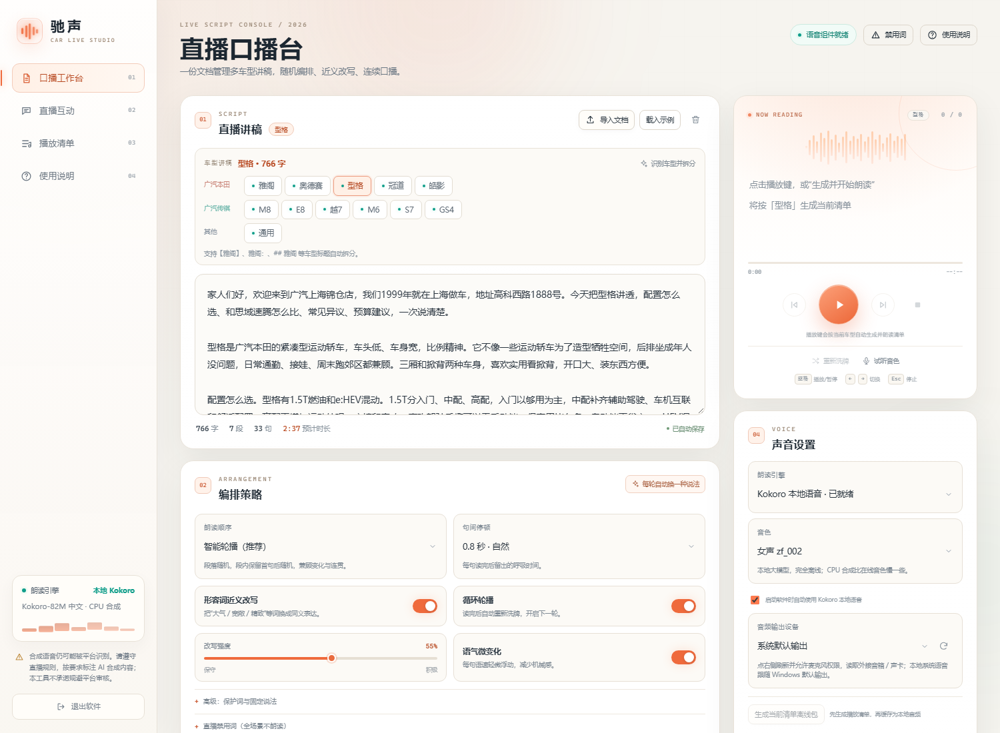
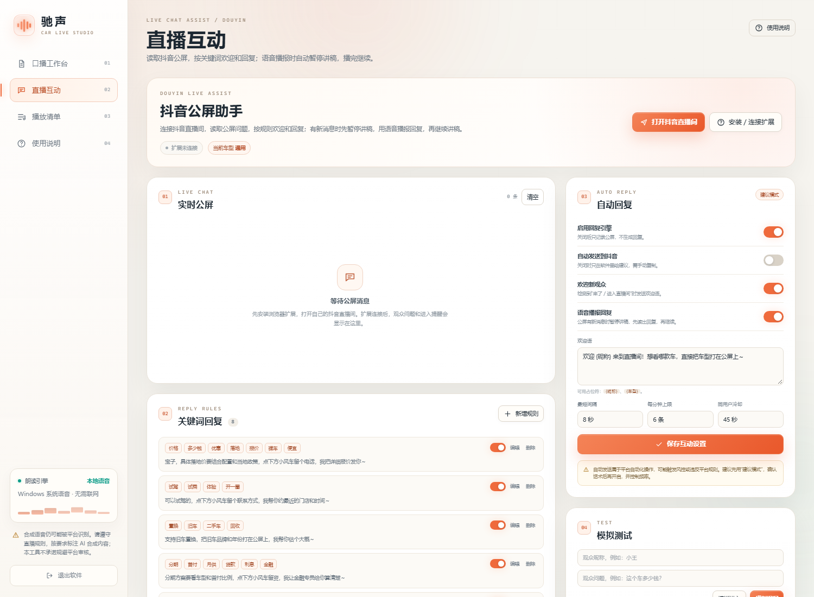

# 驰声 · 汽车直播口播助手

一个跑在 Windows 本机的汽车留资直播口播工具：导入讲稿，自动分段分句、随机编排、把形容词换成近义词，再用自然语音连续朗读。

- 讲稿保存在本机（浏览器 localStorage + 软件目录 `data/state.json`），不会上传到外部服务器。
- 默认使用 Edge / Windows 自带的中文自然音色，打开就能用。
- 可选安装 `edge-tts` 在线语音组件，自动读取普通话、粤语、台湾腔等中文自然音色。
- 支持把当前播放清单逐句缓存成本地音频，生成后可离线播放；也支持选择外接音箱 / 声卡。
- Kokoro 本地语音已内置到启动流程，打开软件会自动拉起，不需要再单独开服务窗口。
- 可选接入 Azure、火山引擎/豆包、阿里 CosyVoice 神经语音：填各自 Key 即可使用，自然度高于 Kokoro/Edge，需要联网。
- 播放清单可以同时勾选多款车型，按预设顺序或随机车型顺序播放，切换时自动插入通用门店讲稿。
- 支持全局禁用词与高危替换：绝对词直接删除，高危词可替换成安全说法；讲稿、公屏回复、访客姓名、私信、测试语音都生效。
- 支持添加本地展厅背景音乐，随机或顺序播放；音乐与讲稿语音独立混音，不会暂停朗读。
- 独立“脚本工作台”管理各车型讲稿；口播工作台只保留选车型、编排、生成和播放。



## 30 秒开始

1. 双击 **`启动软件.cmd`**。
2. 软件会在 Edge 应用窗口中打开（没有 Edge 时用默认浏览器）。
3. 打开左侧 **“脚本工作台”**，粘贴讲稿，或点击“导入文档”选择 `.txt` / `.md` / `.docx`。
4. 整理好后切回 **“口播工作台”**；脚本工作台会留在后台，编辑内容不会丢失。
5. 在“播放车型”区域选择 1 款或多款。
6. 选择编排策略，建议先用 **“安全乱序（按段，推荐）”**。
7. 点击 **“生成播放清单”**。
8. 点击播放器播放键，或 **“播放清单”**。
9. 需要自动回复公屏时，先安装 `douyin-extension` 扩展，再进入左侧 **“直播互动”** 页。
10. 需要完全离线的 Kokoro 语音时，先运行一次 **`安装Kokoro语音.cmd`**；以后打开软件会自动启动 Kokoro，不需要再单独开服务窗口。

关闭软件：点击界面左下角 **“退出软件”**，或双击 **`停止软件.cmd`**。

## 版本与 GitHub

每个版本使用独立标签，例如 `v2.15.0`，GitHub 的 Tags / Releases 可以直接区分。

当前仓库：

```text
https://github.com/chenwj888/chisheng-car-live-assistant
```

版本记录见 `CHANGELOG.md`。

发布新版本时：

1. 同时修改 `app.py` 的 `APP_VERSION` 和 `scripts/health.ps1`；
2. 确认 `git status` 只包含源码改动；
3. 运行：

```powershell
powershell -ExecutionPolicy Bypass -File scripts\sync-github.ps1
```

脚本会：

- 提交源码；
- 创建 `v版本号` 标签；
- 推送 `main` 和标签到 GitHub。

历史标签：

```text
v2.13.0  v2.13.1  v2.13.2  v2.13.3  v2.14.0  v2.14.1  v2.15.0  v2.15.1
```

> 如果电脑上还开着旧版本，新版本会自动换到 `8766` 等空闲端口启动，避免打开旧界面；建议先关闭旧版窗口。车型讲稿保存在浏览器本地，升级不会清空。

> 启动脚本的少量控制台提示使用英文，是为了避免 Windows 代码页导致乱码；软件界面和朗读内容全部为中文。

## 主要功能

### 1. 讲稿编排

- 按空行分段，按中文标点（。！？；…）分句。
- 支持直接粘贴、拖入文件、导入 TXT / Markdown / Word `.docx`。
- 自动统计字数、段数、句数和预计朗读时长。
- 自动过滤 `【音乐】`、`（镜头）` 等舞台提示和表情符号。

### 2. 五种朗读顺序

| 模式 | 说明 |
| --- | --- |
| 顺序朗读 | 保留原稿顺序，适合彩排 |
| 安全乱序（按段，推荐） | 段落随机，段内句子保持原顺序；有前后关系的句子不会被拆开 |
| 全篇句乱序（不推荐） | 全篇句子打散，变化最大，但可能打断强关联句 |
| 段序固定 · 段内变序 | 段落顺序不变，每段保留首句，其余随机 |
| 智能轮播（段内变序） | 段落随机 + 段内保留首句后随机；变化更大，但可能打断强关联句 |

**含“第一、第二、第三”的段落会自动整段保留：**

- 不拆成独立句子；
- 段内顺序不打乱；
- 作为一个完整队列项朗读；
- 形容词近义替换仍然生效；
- 队列里会显示“整段保留”标签。

如果原文把这些序号分成多个自然段（第一段、第二段、第三段），程序会把连续序号段落合并成一个整段再朗读。

### 3. 形容词近义改写

内置汽车口播常用形容词词典，例如：

> 大气 → 有气场 / 沉稳 / 舒展  
> 宽敞 → 宽适 / 阔绰 / 开阔  
> 精致 → 细腻 / 讲究 / 精巧  
> 强劲 → 充沛 / 有劲 / 浑厚

- “改写强度”控制每句替换的概率和数量，建议 **50%–65%**。
- 改写只发生在形容词和程度词上，不改变价格、数字、电话、英文车型名和引号内的固定说法。
- 车名、配置名、价格、电话号码会自动跳过；可在“高级：保护词”中补充不想被改的词。
- 每次重新洗牌都会重新生成说法，循环轮播时每轮不完全一样。

### 4. 朗读与循环

- 生成播放清单后，可以逐句试听、跳句、上一句 / 下一句。
- 支持句间停顿、循环轮播、语气微变化（每句语速轻微浮动）。
- 播放时自动请求屏幕常亮，减少电脑休眠导致的中断。
- 每轮结束自动重新洗牌，并尽量避免上一轮结尾和这一轮开头重复。

### 5. 声音

| 引擎 | 联网 | 说明 |
| --- | --- | --- |
| 本地语音 · 免安装 | 取决于音色 | 调用 Edge / Windows 的系统语音。默认优先选择“晓晓”等自然音色 |
| Edge 自然语音 · 需联网 | 是 | 通过 `edge-tts` 组件调用微软在线音色，需要先安装组件 |
| Kokoro 本地语音 · CPU | 否 | 本地运行 Kokoro-82M-v1.1-zh；安装后由软件自动启动，适合无独显电脑 |
| Azure 神经语音 · 需 Key | 否 | 微软 Azure Speech，音色和风格更接近真人直播；需要 API Key，按量计费 |
| 火山引擎 / 豆包 | 否 | 豆包语音合成，中文直播腔自然；需要 AppID / Access Token |
| 阿里 CosyVoice | 否 | 百炼 CosyVoice 大模型语音；需要 API Key / 业务空间 |

在 Edge 中，“晓晓 / 云希 / 云扬”等标有 **“自然”** 的音色通常是在线自然音色，需要联网；标有 **Huihui / 慧慧** 的通常是离线系统音色。界面里会提示当前音色是否需要联网。

**音色自然度优化**

如果觉得 Kokoro 机械，先点声音设置里的 **“一键自然音色（Edge 晓晓）”**。它会自动：

- 切到 Edge 自然语音；
- 关闭“启动软件时自动使用 Kokoro”；
- 选择晓晓；
- 语速 1.05；
- 音调 0；
- 关闭语气微变化。

这通常比 Kokoro 自然一档。想换男声，再把音色改成“云希 / 云扬 / 云健”。

如果 Edge 仍不满意，需要更高自然度时，可以接 Azure 神经语音、火山引擎/豆包 TTS 或阿里 CosyVoice API；它们需要联网和 API Key，但直播腔更自然。完全离线的高自然度方案（GPT-SoVITS、CosyVoice2）在这台无 NVIDIA 显卡的电脑上实时性不足。

如果系统里没有中文语音：打开 Windows 设置 → 时间和语言 → 语言和区域 → 中文（简体）→ 语音，安装中文语音包。

**音色库与离线包**

- 安装 `edge-tts` 后，“音色”下拉框会自动读取 Edge 的中文音色库；目前包含普通话、东北/陕西口音、粤语、台湾腔等 14 个常用音色，后续服务端增加音色也会自动出现。
- “生成当前清单离线包”会把当前播放清单逐句合成并缓存到本机 `cache` 目录。生成完成后，播放当前清单不再依赖网络。
- 离线包绑定“当前清单 + 当前音色 + 语速/音调”。重新洗牌、换轮改写或换音色后，需要重新生成。
- 这是缓存音频，不是把整个神经网络音色模型下载到本地；如果要任意新文本完全离线合成，需要再接入 Piper 等本地 TTS 模型，模型通常几十到几百 MB，且要逐个确认商用授权。
- Edge 自然语音是免费在线服务，合成时仍需联网；商用直播和平台使用请自行确认服务条款。

**背景音乐**

- 在“背景音乐”卡片点“添加本地音乐”，支持 MP3 / M4A / AAC / WAV / OGG / FLAC / WEBM，单个文件不超过 80MB。
- 可以一次选多首，也可以把文件拖到音乐卡片里；文件会复制到软件目录的 `music/`，下次打开仍在。
- 播放方式支持“随机”和“顺序”；点播放键开始，点下一首切换，音量单独调节。
- 背景音乐由独立播放器播放，**不会暂停、打断或改变讲稿朗读和公屏语音回复**；它只是和语音一起送到同一个输出设备。
- 音乐请使用你拥有播放权的素材；不要用背景音乐伪装真人直播或规避平台识别。

**输出设备**

- “音频输出设备”只对 Edge 自然语音生效；点右侧刷新并允许浏览器读取设备后，可以选择外接音箱 / 声卡。
- 本地语音由 Windows 系统播放，不能单独指定输出设备；请把 Windows 默认输出改成外接音箱，或在 OBS 里采集正确的桌面音频。

### 6. 多车型播放清单

- 在“播放清单”卡片勾选多款车型，可以按车型列表的**预设顺序**，也可以选**随机车型**。
- 每款车都从自己的讲稿单独生成，队列里带车型标签，**不会把雅阁、奥德赛、M8 的句子混在一起**。
- 播放清单顶部显示“已选车型 / 正在讲 / 下一个”，播放时能直接看到当前和下一款车型。
- 播放车型和编辑车型分开：上方“编辑车型”只决定当前编辑哪份讲稿，播放车型在“1. 选择播放车型”里单选或多选。
- 选 1 款就生成单车型清单；选多款就生成多车型清单，车型可以按目录顺序或随机顺序。
- 勾选“切换时插入通用讲稿”后，会在每款车之前插入“通用插入语”，可以写点赞、关注、转发、公屏互动、门店优势、地址、1999 年开业、优惠政策等。
- 默认通用插入语已经带一段互动话术；可以在多车型面板里直接修改，独立于各车型讲稿。
- 多车型面板还增加了“单车型播放时也插入互动话术”开关，以及单独的“单车型互动话术”文本框；默认开启，单车型清单开头会先播这段互动。
- “换一轮”会重新编排多车型清单；循环播放也按多车型清单重建。

### 7. 全局禁用词与高危替换

打开方式有两种：

- 直接点右上角的 **“禁用词”** 按钮，会自动展开并滚动到设置面板；
- 或者在“高级：保护词与固定说法”下面打开 **“直播禁用词（全场景生效）”**。

设置面板分两块：

**绝对禁用**

- 每行一个，也支持逗号、顿号分隔；
- 匹配到的词直接删除，不朗读；
- 例如：`最低价`、`百分百`、`私下交易`。

**高危替换**

- 输入“高危词”和“替换词”，点“添加”；
- 可以逐条编辑、删除；
- 例如：`绝对` → `非常`、`最便宜` → `更实惠`、`保证` → `尽量`；
- 点“保存全部”后立即生效。

**导入 / 导出**

- **导出禁用词**：把绝对禁用词导出为 TXT，一行一个；
- **导出表格**：把高危替换表导出为 CSV，列为“高危词,替换词”，带 BOM，Excel 直接打开不乱码；
- **导入表格**：支持 CSV / TXT，表格需要两列“高危词、替换词”，也可以用 `高危词=替换词` 的文本；
- 导入表格会**替换当前高危替换表**（会先弹确认），不会动绝对禁用词；
- “上传 TXT / CSV”仍然保留，用于把绝对词和替换规则一起追加。

绝对禁用与高危替换保存在同一个 `data/blocklist.json` 中，并自动保留一份 `data/blocklist.backup.json`。

**长期保存机制**

- 修改后约 0.7 秒自动保存，不需要每次点按钮；
- 点“保存全部”会立即同步；
- 同时写入浏览器本机缓存和软件目录；
- 刷新页面、关闭浏览器、重启软件都会保留；
- 刷新时会对比浏览器缓存和软件文件的更新时间，保留较新的那份；
- 如果本地服务一时没写成功，浏览器缓存会先保住，下次打开自动补写；
- `data/blocklist.json` 损坏或丢失时，会尝试读取 `data/blocklist.backup.json`；
- 建议定期用“导出禁用词”和“导出表格”做一份外部备份。

保存位置：

```text
data/blocklist.json
```

作用范围：

- 讲稿朗读：生成清单时先替换/删除，队列里也不会出现绝对禁用词；
- 公屏弹幕回复：服务端生成回复后先清洗，再返回给扩展；
- 访客姓名：欢迎语里的昵称也会清洗或替换；
- 私信回复：和公屏走同一套服务端过滤；
- 自动发送到抖音：发给扩展的文字已经清洗；
- 测试语音、Kokoro / Edge / 本地语音：TTS 接口和前端朗读前都会再过滤一次。

绝对禁用词直接删除；高危词替换成你填写的安全说法。若整句被过滤成空，会提示并跳过，不会读出空音。

### 8. 导出

“播放清单”右上角可以导出当前这一轮的完整句子，TXT 格式，方便审稿或留档。

## 多车型讲稿库

软件内置广汽本田、广汽传祺共 11 个车型的独立讲稿位：

- **广汽本田**：雅阁、奥德赛、型格、冠道、皓影
- **广汽传祺**：M8、E8、越7、M6、S7、GS4
- **通用**：不属于具体车型的开场、结尾或共用话术

### 上传一份多车型文档

文档按下面的标题格式分段即可，标题行不会被朗读：

```text
【雅阁】
雅阁的外观大气，空间宽敞。

奥德赛：
奥德赛适合全家出行。

## 广汽传祺 M8
M8 的二排乘坐舒适。

GS4
GS4 性价比高。
```

支持 `【雅阁】`、`雅阁：`、`## 雅阁`、`广汽本田 雅阁`、`M8 车型讲解` 等写法。导入后会自动拆分到对应车型，并在车型按钮上显示绿点。

- **导入含 2 个以上车型的文档**：会按文档重建车型讲稿库，导入前会确认。
- **导入只有一个车型的文档**：只更新该车型，其他车型保留。
- **粘贴文本后**：点击“识别车型并拆分”可以把当前文本拆到多个车型。
- **切换车型**：如果正在朗读，会先停止，再载入对应车型讲稿；播放清单按车型独立生成。

## 直播互动（抖音公屏）

左侧导航进入 **“直播互动”**，可以读取自己的抖音直播间公屏，按关键词规则欢迎新观众、回复问题。

### 安装浏览器扩展（只需一次）

抖音页面不允许普通网页直接读取它的聊天 DOM，所以需要一个很小的本地浏览器扩展做“桥”：

1. 用 Edge 打开 `edge://extensions`（Chrome 用 `chrome://extensions`）。
2. 打开右上角 **“开发者模式”**。
3. 点击 **“加载解压缩的扩展”**。
4. 选择软件目录下的 **`douyin-extension`** 文件夹。
5. 打开 `https://live.douyin.com/`，登录并进入 **自己的直播间**。
6. 回到软件的“直播互动”页，看到 **“抖音扩展已连接”** 即成功。

扩展只读取当前抖音页面的公屏文字，并把消息发到本机 `127.0.0.1` 的驰声服务；不会把聊天上传到外部服务器。

### 回复模式

- **建议模式（默认）**：规则命中后只在软件里显示建议回复，不向抖音发送，最安全。
- **自动发送**：在软件里打开“自动发送到抖音”并确认风险后，扩展才会尝试填入输入框并发送。
- 内置最短间隔、每分钟上限、同用户冷却和重复消息去重，默认 8 秒 / 6 条每分钟。
- 支持欢迎新观众，欢迎语可用 `{昵称}` 和 `{车型}` 占位符。
- “语音播报回复”默认开启；如果只想看文字不想打断讲稿，可以在直播互动页关闭。
- 验证方法：先播放讲稿，再到“直播互动”点“模拟提问”。讲稿应暂停，先读出回复，然后继续。
- 使用“本地语音 · 免安装”引擎时，回复后会从当前句重新继续（同一句可能重读一次）；使用“Edge 自然语音”引擎时，会从被打断的位置继续。
- 关键词规则、欢迎语、频率都可编辑；规则可单独启用/停用。



### 语音包和离线播放说明

- 音色列表来自 Edge 在线语音服务，免费但合成时需要联网；软件会把生成过的句子缓存在本机 `cache` 目录。
- “生成当前清单离线包”缓存的是**当前这一轮播放清单**。重新洗牌、重新生成或换轮改写后，文本变了，需要重新生成。
- 这不是“克隆某个真人”的模型，而是使用授权的神经网络音色；不要用未经授权的人声做克隆。
- 输出设备选择依赖浏览器支持；如果本地语音无法指定外设，请在 Windows“声音设置”里把默认输出改成外接音箱 / 声卡。
- 背景音乐和 Edge 自然语音会尽量跟随“音频输出设备”选择；本地语音仍跟随 Windows 默认输出。

### 重要限制

- 抖音网页版是动态页面，**页面结构或风控策略更新后，公屏读取可能失效**。扩展设置里提供了聊天容器、消息节点、输入框、发送按钮选择器，可手动调整。
- 自动发送属于平台自动化操作，可能触发风控或违反平台规则；请只在自有直播间使用，控制频率，并遵守平台规则。
- 本功能不绕过登录、验证码、实名或平台安全限制，也不保证长期可用。
- 建议先用“建议模式”跑一段时间，确认回复话术和频率，再小流量开启自动发送。

## 火山引擎 / 豆包语音（可选）

1. 在火山引擎豆包语音控制台开通“语音合成”；
2. 获取 AppID、Access Token；
3. 声音设置 → 朗读引擎选 **火山引擎 / 豆包**；
4. 填 AppID、Access Token、Cluster（通常 `volcano_tts`）；
5. 选择音色，点“试听音色”。

说明：

- 当前走豆包语音 v1 HTTP 非流式接口；
- 音色 ID 使用豆包语音控制台的 `voice_type`；
- AppID/Token 只保存在本机 `data/state.json`；
- 不同账号可用音色可能不同，面板内置的是常用音色。

## 阿里 CosyVoice（可选）

1. 在阿里云百炼开通 CosyVoice；
2. 获取 API Key 和业务空间 ID（Workspace ID）；
3. 声音设置 → 朗读引擎选 **阿里 CosyVoice**；
4. 填 API Key、业务空间 ID，选择地域（北京 / 新加坡）；
5. 选择模型（推荐 `cosyvoice-v3-flash`）和音色；
6. 点“试听音色”。

说明：

- 当前走 CosyVoice 非实时 HTTP 接口；
- 填业务空间 ID 后使用专属域名；留空会尝试公共域名；
- 音色需要和模型匹配；
- API Key 只保存在本机 `data/state.json`。

## Azure 神经语音（可选，推荐自然度）

如果 Edge/Kokoro 仍觉得机械，可以用 Azure 神经语音。

1. 在 Azure 门户创建 **Speech** 资源；
2. 复制“密钥”和“区域”，例如 `eastasia`、`eastus`；
3. 打开软件 → 声音设置 → 朗读引擎选 **Azure 神经语音 · 需 Key**；
4. 填入 Key 和区域，选择音色（晓晓 / 云希 / 云扬等）和风格；
5. 点“试听音色”。

说明：

- Key 保存在本机 `data/state.json`，合成时只发送给微软 Azure；
- 不要把 `data/state.json` 发给别人；
- Azure 有免费额度，超出后按字符/时长计费，具体以 Azure 官网为准；
- 商用直播请确认 Azure 服务条款和授权；
- 风格不是每个音色都支持；不支持时服务端会自动退回“通用”再试一次；
- 单句文本会发送到 Azure 云端，敏感内容请先确认合规。

## 安装 Edge 自然语音组件（可选）

默认不需要安装任何东西。只有想使用软件里的 **“Edge 自然语音 · 需联网”** 引擎时，才需要：

1. 双击 **`安装自然语音.cmd`**。
2. 等待下载安装完成。
3. 重新启动软件，朗读引擎里会出现 **“Edge 自然语音 · 已就绪”**。

安装会新建一个 `vendor-日期-时间-随机数` 目录，不会覆盖正在运行的旧组件，因此软件开着也可以安装；重启后自动使用最新组件。旧版遗留的 `vendor/` 目录可以保留，不影响使用。

组件安装在软件目录的 `vendor/` 中，不污染系统 Python。若网络无法访问 PyPI，安装会失败，但“本地语音”仍然可用。

> 商用提醒：`edge-tts` 是社区组件，调用的是微软 Edge 的在线语音接口，适合测试和个人使用。正式商用直播建议使用有明确商用授权的 Azure 语音服务或其他授权 TTS，并遵守相应条款。

## Kokoro 本地语音（可选，完全离线）

Kokoro 是 82M 参数的中文语音模型，CPU 可以运行，适合这台没有 NVIDIA 显卡的电脑。它不是克隆音色，只能使用模型自带的预设音色。

**安装**

1. 确认电脑有 Python 3.12（没有的话安装 Python 3.12，或安装 uv；软件主程序继续用 3.14 不影响）。
2. 双击 **`安装Kokoro语音.cmd`**。
3. 脚本会在 `kokoro-service` 里创建独立 `.venv`，安装依赖并修正 Kokoro ONNX 的兼容问题。

**启动**

1. 安装完成后，直接双击 **`启动软件.cmd`**。软件会在后台自动拉起 Kokoro 服务，不再需要单独开黑窗口。
2. 第一次受控启动会自动下载约 380MB 模型到 `kokoro-service/models`，请保持网络；模型下载完成后，以后启动只需几秒。
3. “声音设置”里保持 **“启动软件时自动使用 Kokoro 本地语音”** 勾选，软件就绪后会自动切到 Kokoro；也可以手动选其他引擎。
4. 音色列表会自动读取 100 个左右的中文预设音色，分女声 / 男声。
5. 只有在排查问题时，才需要手动运行 `启动Kokoro语音.cmd`；手动启动的服务不会被软件退出时关闭。

**说明**

- 这是完全本地合成，不把文本发到外部；模型加载后断网也能用。
- i5-1135G7 这类 CPU 上，短句大约 1–3 秒，长句更久；生成过的句子会缓存，第二次很快。
- 模型约 380MB，不放进软件 ZIP；`kokoro-service/models` 由首次启动下载。
- 模型是 Kokoro-82M-v1.1-zh，许可以模型主页为准；个人非商用使用没有问题，商用请自行确认。
- 如果 Kokoro 环境未安装或服务启动失败，软件会自动回退到“本地语音”，不会导致讲稿无法播放。
- Kokoro 服务的启动日志在 `kokoro-service/kokoro.log`；关闭软件时，由软件自动启动的服务会一起关闭。

## 接到 OBS / 直播软件

1. 在 OBS 中添加 **“音频输出采集”**（桌面音频）。
2. 选择运行本软件的 Edge 浏览器，或选择系统默认输出设备。
3. 如果只想采集软件声音、不想采集其他系统声音，可以安装 VB-Audio Virtual Cable，把软件输出到虚拟声卡，再在 OBS 中采集该声卡。
4. 直播时保持软件窗口打开，关闭系统通知和自动更新弹窗。

## 合规提醒

这个工具做的是 **内容随机化、近义改写和语音朗读**，它能降低长时间重复带来的机械感，但 **不能保证、也不承诺让内容不被平台识别为 AI 直播**。

- 合成语音直播可能受平台规则限制；如果平台要求标注“AI 合成”，请按要求标注。
- 不要用本工具冒充真实主播、伪造真人出镜或做虚假承诺。
- 汽车价格、优惠、金融方案、试驾权益等宣传内容，请遵守广告法和平台规则，以实际政策为准。
- 随机打乱句子可能造成语义跳跃；正式直播建议使用“安全乱序（按段）”，并在开播前完整试听一轮。
- 本工具不提供用于规避平台 AI 识别、对抗检测的随机环境音或类似功能；请不要用背景噪声伪装真人直播。

## 常见问题

**没有声音？**  
先点“试听音色”。检查系统音量、浏览器是否静音、OBS 是否采集了正确的输出设备。若当前音色是在线自然音色，检查网络；也可以换一个 Huihui 等本地音色。

### Edge 显示“需通过启动脚本打开”

说明页面不是从本机服务打开的，或者服务还没连上：

- 不要直接双击 `static/index.html`；
- 双击软件目录里的 **`启动软件.cmd`**；
- 已经打开页面时，刷新一次即可；
- 页面现在会自动重试本地服务，服务启动后 Edge 选项会自动恢复“已就绪”；
- 也可以点页面右上角的状态胶囊手动重连。

**声音太机械？**  
优先选择“晓晓 / 云希 / 云扬”等自然音色；或安装 Edge 自然语音组件后切换引擎。适当把语速调到 `0.95–1.05`，开启“语气微变化”。

**直播互动显示“扩展未连接”？**  
先确认软件已启动；在 `edge://extensions` 确认扩展已加载并启用；打开自己的抖音直播间后刷新页面。若仍不行，到扩展设置里点“测试连接”，并检查软件实际端口。

**扩展连接了但读不到公屏？**  
抖音页面结构可能变了。打开扩展设置，调整“聊天列表容器 / 单条消息节点”选择器；也可以在扩展设置里开启调试日志，在直播间按 F12 查看 `[驰声互动]` 日志。

**导入 Word 失败？**  
本软件只支持 `.docx`，不支持老式 `.doc`。可以在 Word 中“另存为” `.docx` 或 `.txt` 后再导入。

**端口被占用或旧版本还在运行？**  
新版本会自动尝试 `8765–8804`，把实际地址写入 `runtime.json`；如果检测到旧版本占用 `8765`，会改在 `8766` 等端口启动，不会打开旧界面。建议先关闭旧版，或先运行一次新版目录里的 `停止软件.cmd`。

**双击 `启动软件.cmd` 出现“不是内部或外部命令”或一堆乱码？**  
请确认使用的是最新 ZIP，并且已经**完整解压**后再双击，不要直接在压缩包预览窗口里运行。旧版启动脚本的换行符/编码问题已修复；如果旧目录还在，建议删除旧目录后重新解压，避免新旧文件混用。

**窗口没有自动弹出？**  
手动用浏览器打开 <http://127.0.0.1:8765>。如果端口被占用，请查看软件目录下 `runtime.json` 里的实际地址。

**讲稿会上传吗？**  
不会上传到本项目或外部服务器。讲稿保存在浏览器 `localStorage`，同时自动备份到软件目录的 `data/state.json`，只在本机。使用“Edge 自然语音”在线合成时，单句文本会发送到微软语音服务；介意的话请使用本地系统语音。

**换电脑怎么迁移车型讲稿？**  
关闭软件后，复制整个 `data/` 目录到新电脑的同名位置即可；也可以继续用浏览器本地副本。

**怎么彻底退出？**  
点击界面左下角“退出软件”，或双击 `停止软件.cmd`。

## 文件结构

```text
car-live-assistant/
├─ 启动软件.cmd            # 双击启动
├─ 停止软件.cmd            # 停止本地服务
├─ 安装自然语音.cmd        # 可选：安装 edge-tts
├─ app.py                  # 本地静态服务 + 可选 TTS 接口
├─ scripts/
│  ├─ health.ps1           # 启动后检查本地服务
│  └─ stop.ps1             # 读取端口并发送退出指令
├─ static/
│  ├─ index.html
│  ├─ styles.css
│  ├─ core.js              # 分段、分句、乱序、近义改写
│  └─ app.js               # 播放器与界面交互
├─ tests/
│  └─ test-core.js         # 文本处理自动化测试
├─ docs/                   # 界面预览图
├─ douyin-extension/       # 抖音直播互动浏览器扩展
├─ kokoro-service/         # Kokoro 本地语音服务（模型和 .venv 不放进 ZIP）
├─ data/                   # 车型讲稿 / 互动设置 / 禁用词与备份（自动生成）
├─ vendor/                 # 安装自然语音后生成
├─ cache/                  # 在线语音缓存
├─ music/                  # 用户添加的背景音乐
└─ logs/                   # 运行日志
```

## 开发 / 测试

```powershell
# 启动本地服务（不自动打开窗口）
python app.py --no-browser

# 文本处理测试（需要 Node.js）
node tests/test-core.js
```

默认地址：<http://127.0.0.1:8765>
